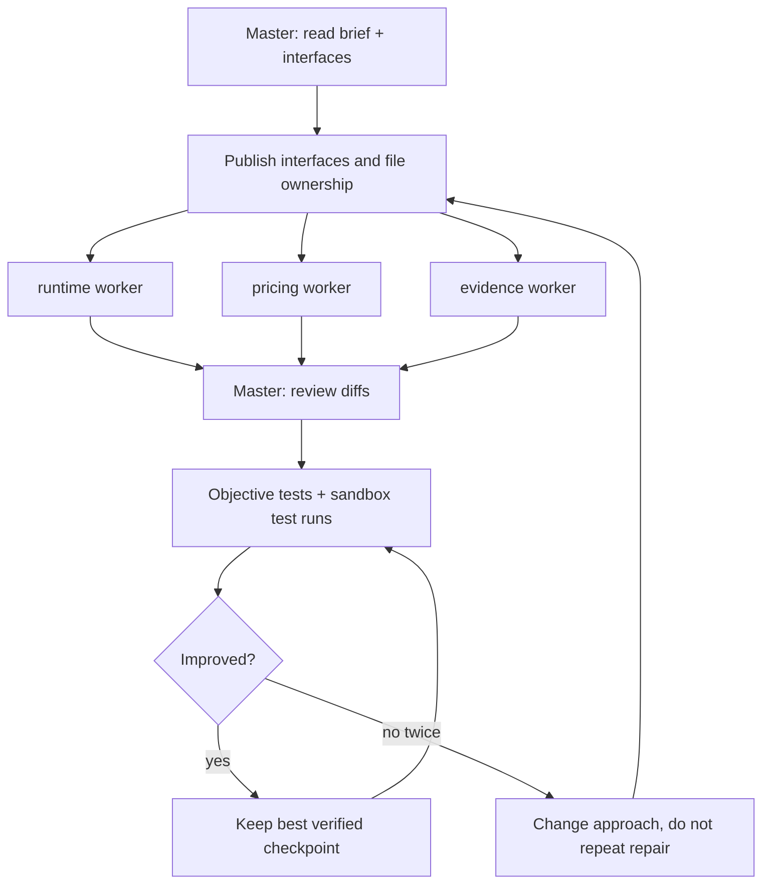
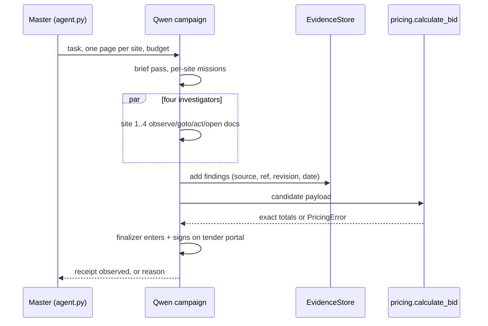

# Implementation

How this agent works, why it is built this way, and what has actually been verified. Nothing here carries a
scenario fact: the sites, logins, prices, dates and totals of a run arrive only through `task["access"]`,
`task["brief"]` and what the model reads during that run.

## Challenge interpretation (source-linked)

Sources: [the challenge brief](https://ehl-challenge.atira.ai/challenges/rfq),
[the run contract](https://ehl-challenge.atira.ai/docs/run-contract.md),
[fair play](https://ehl-challenge.atira.ai/docs/fair-play.md), [scoring](https://ehl-challenge.atira.ai/docs/scoring.md),
plus `AGENTS.md` and the [recursive skill's upstream](https://github.com/lollipopkit/cc-plugins).
Per those sources and the docstrings of `run.py` and `agent.py`, the task is a **model-directed browser agent**:
not a document generator and not a generic procurement tool.

- One run gives access to four generic German-language websites — a **tender portal** holding the bid configurator,
  a **buyer specification portal**, an **ERP system** and a **mailbox** — each with its own login in
  `task["access"]`, plus a Markdown `brief` with the task's own rules and an `answer_schema`.
- The answer is a single **NET EUR** bid. Where `submission.kind` is `site`, it is entered on the tender portal and
  signed with a short-lived **TAN that arrives in the run's mailbox**, and the website's receipt is the proof;
  a `site` answer is never POSTed to the API (`run.submit_answer` refuses it, `agent.solve` returns `None`). Where
  the kind is `api`, a schema-valid candidate is POSTed once (`202` = accepted and final).
- A scored run lasts **20 minutes** and the server's `expires_at` ends it;
  [scoring](https://ehl-challenge.atira.ai/docs/scoring.md) filters eligible answers first, then ranks by answer
  quality, then by **LLM cost × run time** — so a correct-but-expensive agent can lose to a correct-and-cheap one.
  At most **4 CDP browsers** are supplied; the sandbox stops browsers we launch ourselves.
- **All model calls go through the hosted proxy** ([models](https://ehl-challenge.atira.ai/docs/run-contract.md#llm-calls));
  tools, pages and documents are untrusted input.

Per `.dev-input/implementation-task.txt`, arithmetic and reference/date/authority reconciliation dominate the score.

## Architecture: options considered

1. **A scripted click path, or crawl-everything-then-one-shot LLM.** Rejected:
   [fair play](https://ehl-challenge.atira.ai/docs/fair-play.md) rejects a fixed script or a general crawler in place
   of the model, and the scored dataset is not the public rehearsal, so a hard-coded path is dead code there.
2. **One monolithic agent in one browser.** Kept as the **viable fallback** (it is how the kit's `solve(task, page)`
   works, and nothing about 20 minutes makes it impossible), but not chosen: four sites serialise behind one tab and
   an agent holding three portals at once loses track of which source said what.
3. **Chosen: model-directed campaign with shared evidence** (`atira_agent/runtime.py:run_campaign`): a brief pass
   writes per-site missions → per-site Qwen investigators run in parallel, **one page each**, choosing navigation,
   searches, documents and fields through tools → findings land in a shared `EvidenceStore` → a synthesis pass calls
   the pure Decimal calculator to build the candidate → for a `site` run a finalizer enters, signs and reads the
   receipt, and claims success only if a fresh observation of the portal shows it.

Evidence must be shared because the answer is cross-site: a specification revision on the buyer portal, stock in the
ERP and a delivery confirmation in the mail all qualify the same line. `atira_agent/evidence.py` keeps source,
reference, revision and document date per record, with `find_latest`, `invalidate`, `supersede` and `conflicts`, so a
newer revision wins by rule rather than by whichever investigator spoke last.

### Quoracle, evaluated as a development orchestrator

[Quoracle](https://github.com/shelvick/quoracle) came up as a way to run this development loop. Read that way — not
as the scored runtime — it is an Elixir/Phoenix + Postgres multi-agent UI in beta, so adopting it means operating a
stack plus its provider and tool integration, and adding a consensus round per decision, at a moment when a working
Atira-hosted Qwen client with tool calls is already wired up (three workers, file ownership, tests) and the deadline
is tomorrow. The coordination overhead buys agreement we already get from reading diffs and running tests. No legal
review was done and none is claimed here; the reason to skip it is engineering cost and time, not licensing. If
development later needs several humans watching one plan, re-evaluate. We keep the MIT-licensed recursive skill
instead (`THIRD_PARTY_NOTICES`, upstream pinned) — it structures the loop we already run.

## Model roles

- **Qwen3.8-Flash-Next** (`models.QWEN_MODEL`; tool calls, images, 256k context) is the only authority: it picks
  URLs and searches, opens pages, decides which document to open and which page of it, fills fields, reads
  screenshots, judges whether a page is a receipt, and chooses the candidate. Helpers (`documents.py`,
  `pricing.py`, `evidence.py`) parse selected content and calculate; they never decide.
- **Clef** (`models.ask_clef`, `atira_agent/runtime_models.decide_typed`) is optional and typed: a low-stakes choice
  among options the caller supplies. It has no extraction, pricing or compliance authority and must not be required
  (`agent.json` lists `models: ["qwen"]`; without `CLEF_BASE_URL` the call simply returns `None`).

## Documents and OCR

`atira_agent/documents.py` touches only bytes the model selected (helpers never fetch): size caps, format sniffing,
a **PDF text page index** (`pdf_texts`, capped pages) and **PNG rendering of a selected page** (`pdf_render_png`)
for hosted Qwen vision. No local OCR engine, no local model: "OCR" here means the PDF's text layer when it has one,
and a page read by the hosted vision model when it does not. ZIP entries are listed and read with name-safety and
byte caps; a hostile archive is parsed, never executed.

## Pricing rules

Duties split cleanly: **which** material is active, **which** revision and record authority wins and **which**
delivery or stock fact applies are the Qwen investigators' evidence decisions, recorded in `EvidenceStore` with their
source and date. `atira_agent/pricing.calculate_bid(payload) -> dict` then does pure `Decimal` arithmetic on what it
is handed, validates the payload's own attributes and raises `PricingError` on malformed input — a bad fact is loud
rather than a plausible wrong total, and the calculator claims no knowledge it was not given.

Its rules, at a high level: quantity updates and withdrawn lines; "Satz"-type units; per-position price scales and
currency conversion; an active technical-material match against the attributes given; aggregated stock; date-indexed
metal prices; director-discount thresholds with their scope clauses; shared setup allocations; packaging; a marginal
project bonus allocated by largest remainder with ascending position-id ties; confirmed delivery; unit price rounded
*before* line totals; line totals summed. The input schema and boundary expectations live in
`atira_agent/pricing.py` and `tests/test_pricing.py`, not here.

## Evidence vs Entire

`EvidenceStore` is the runtime's belief state: shared between investigators, queryable by reference and authority,
able to mark a record superseded when a newer revision turns up. **Entire** is a development-time session and
checkpoint tool; its refs must never be pushed to a public origin and it cannot carry bid state into a run, so it is
no substitute for runtime evidence state. `atira_agent/events.py` writes one line per event with phase, counts,
numeric token counters and error *classes* only — no payloads, no credentials, no TAN; free text is redacted.

## Recursive development (plan-run-review)

Operator workflow: 1) edit; 2) `uv run --group dev pytest`; 3) `uv run --group dev ruff check .`;
4) `uv run python scripts/package_release.py plan`; 5) `... stage --out ../release-stage`; 6)
`... check --target ../release-stage`; 7) `atira test-run ../release-stage --challenge rfq --no-open`
(the allowlisted staging tree, never `.`); 8) read the run through the MCP debug tools (logs, model calls, profile,
screenshots, inputs) and diagnose; 9) fix, re-test, keep the best measured checkpoint. No scored submission without a
verified baseline.

Runtime budget: `agent.RUN_LIMIT_SECONDS = 1200` monotonic, **and** capped by the server's `expires_at`, whichever
comes first (`make_budget`), enforced by an outer `wait_for` in `solve` so no phase can overrun it. Reserve 240 s for
synthesis and signing; investigators stop 120 s early; per-tool timeouts 45 s browser / 20 s document / 5 s
evidence; the finalizer gets two attempts; the answer POST is clamped to the time that is left rather than dropped,
and is skipped only once `expires_at` has passed.

## Production cost and time vs coding effort

[Scoring](https://ehl-challenge.atira.ai/docs/scoring.md) ranks eligible answers by quality, then by LLM cost × run
time, so in production the money and minutes per run are the optimisation target: fewer and shorter model calls,
parallel investigators, cheaper passes wherever the model only routes. Development time is the opposite resource:
the code should stay small, deterministic helpers around the model's decisions. Concretely: the packager and these
gates cost code lines and buy no leaderboard position, while they prevent a refused or bloated upload that would
cost a whole scored run; the same logic decides everything else in the tree — measure runs, add code only for a
demonstrated failure, and prefer a cheaper model call over a cleverer helper when both give the same answer.

## Limitations and honest validation status

What has been run, as of this writing:

- **Kit contract + entrypoint integration: 27 passed** (`tests/test_kit.py` 14, unmodified, and
  `tests/test_integration.py` 13): four CDP pages, a site run never POSTed, schema-gated candidates, the monotonic +
  `expires_at` clock, the outer deadline, browser detach, redacted events, and the packager's exact-runtime allowlist
  with its stage-target guards (empty/stray-file/duplicate refusal, source-root/ancestor/symlink/foreign-folder
  guards, atomic rebuild that survives an unparsable source, no `__pycache__` in the stage; verified against a real
  `atira test-run --dry-run`, which reports exactly the 16 planned files).
- **Full offline suite at this pass: 183 passed, 11 failed** (194 tests total) — the 11 are other workers' known
  open items (the pricing doc line-count assertion; runtime finish-shape, kwargs-schema and tool-schema tests;
  browser-fixture tests), assigned to the runtime and core PRs, not fixed here. An earlier snapshot of this document
  claimed "128 core passed"; that figure was stale and the full counts above are what actually ran.
- **Sandbox test run 01: failed** with HTTP `400` on a missing `type` in a tool schema; fixed, and a second hosted
  two-call rehearsal **passed**. **Sandbox test run 02** (`run_afb43043d3561d5a`, unranked): **failed, no answer** —
  255 model calls, 388.461 s of run time; all four site investigators hit their 60-step cap repeating identical
  clicks on one site (the customer portal), and the synthesis pass hit its 14-step cap without ever calling the
  calculator. The repair (stall detection, forced replan/observe, wired deadline, candidate persistence) is the
  runtime PR's brief. No end-to-end scored-style rehearsal has finished, so **no sandbox score is claimed and no
  scored submission has been made**; the master records run results.
- `ruff check agent.py scripts tests/test_integration.py atira_agent/events.py`: only `BLE001` broad-`except`
  notices remain (five), deliberate because a crash must never hide an answer. Repo-wide `pytest` still fails in
  another worker's files (`tests/test_runtime.py`, `tests/test_runtime_browser.py`, `tests/test_pricing.py`) —
  open, not fixed here.
- With fewer browsers than sites every site still gets a page, but sites beyond the browser count share one and the
  campaign slows; `agent.json` requests 4.
- Receipt detection is a generic word guard plus the model's reading of a fresh observation, so a false "submitted"
  is possible in principle; `submitted` needs the finish flag, a receipt string and a page that does not contradict.
- Development uses the public scouting logins (`atira scout --env`), which never count; run evidence, transcripts and
  `.dev-input/` are excluded from the release by `scripts/package_release.py`.
